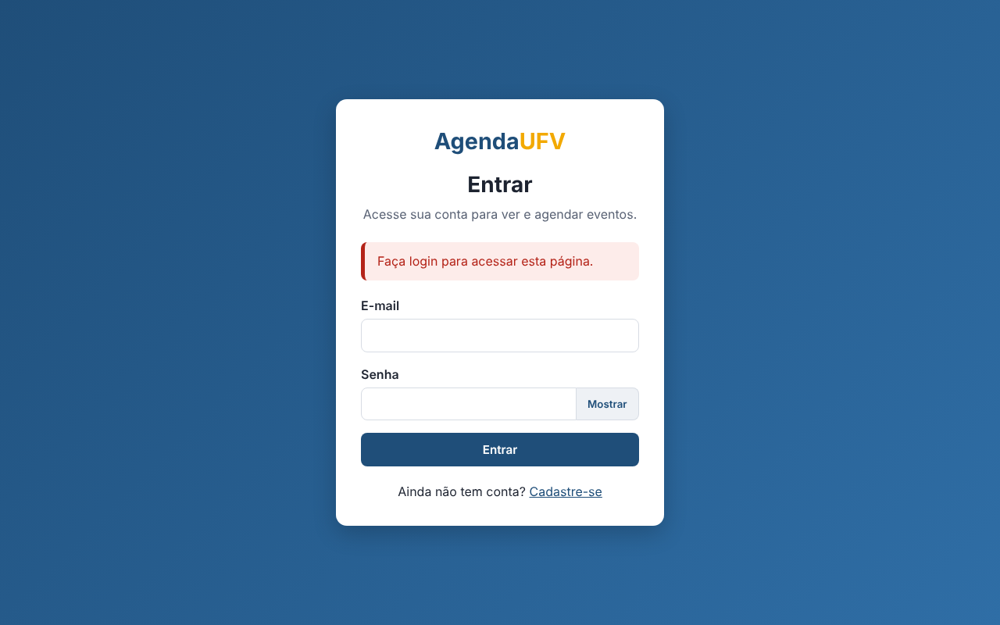
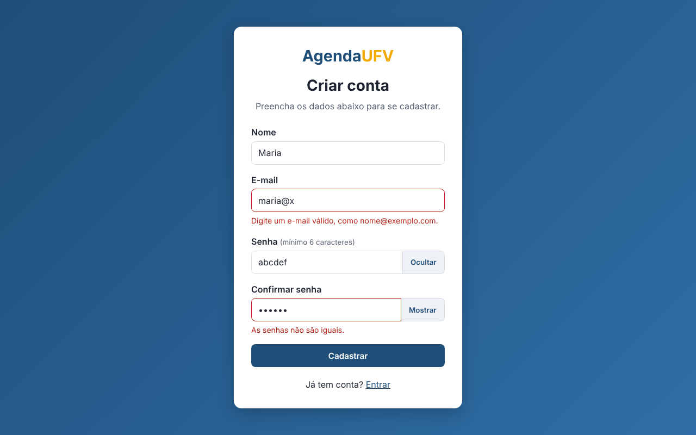
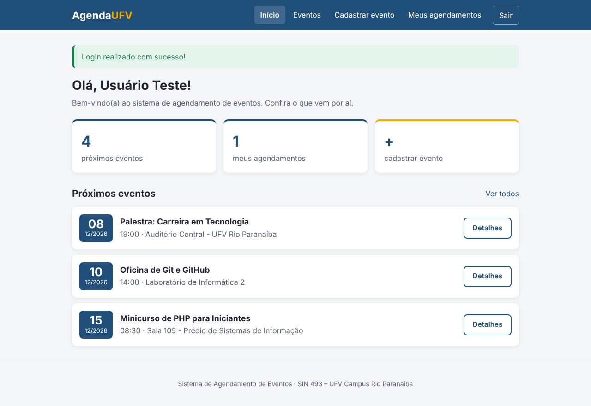
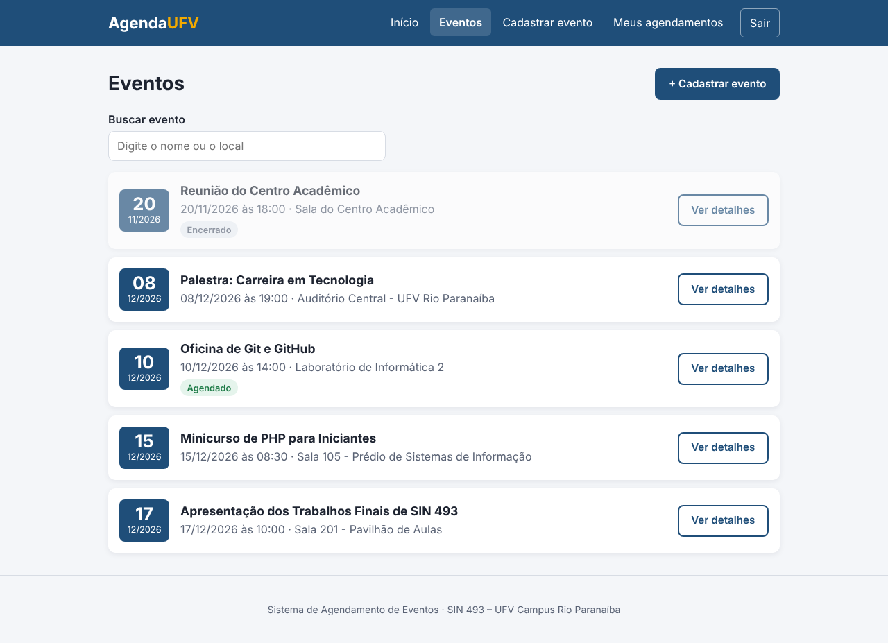
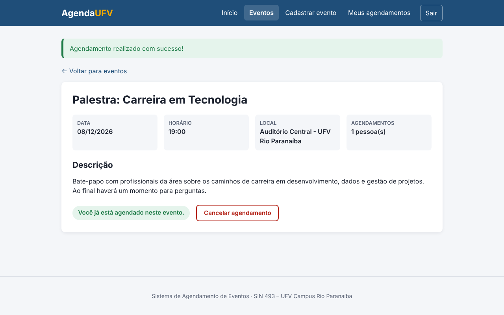
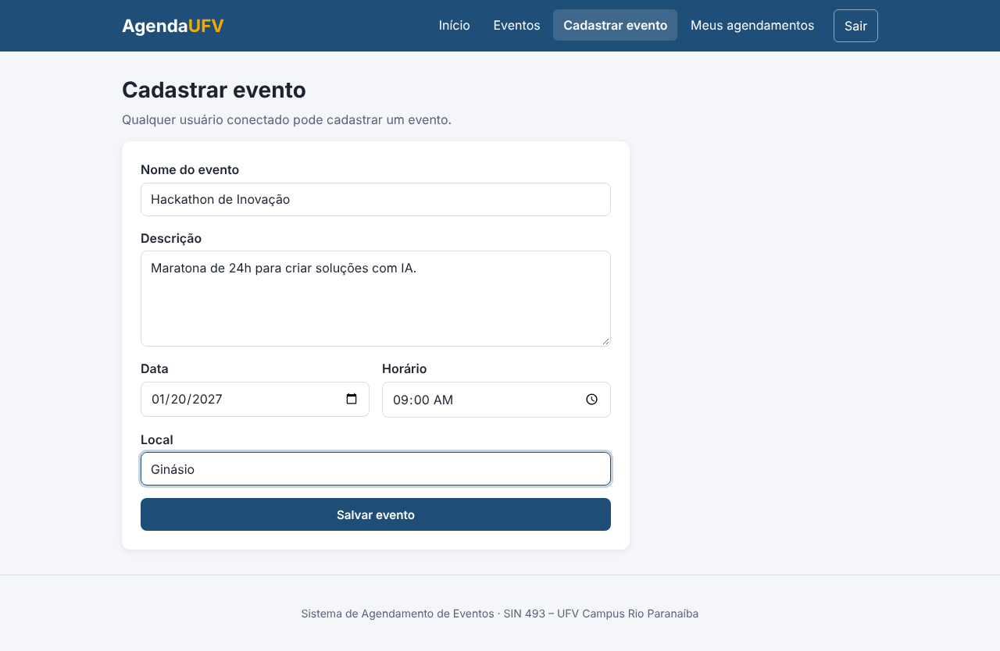
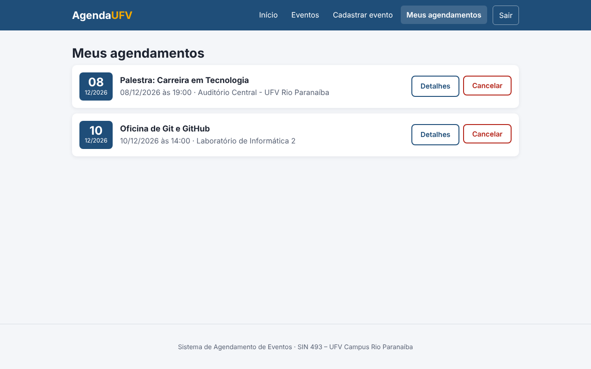
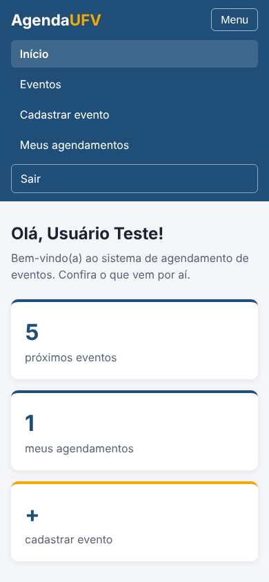

# Agenda UFV – Sistema de Agendamento de Eventos

Trabalho final da disciplina **SIN 493 – Tópicos Especiais III: Introdução à Programação Web**
Universidade Federal de Viçosa – Campus Rio Paranaíba · Prof. Bernardo Teixeira de Miranda

## Objetivo

Sistema Web simples para cadastro e agendamento de eventos (palestras, oficinas, minicursos, reuniões etc.). A pessoa cria uma conta, entra no sistema, consulta os eventos, vê os detalhes, cadastra novos eventos e faz ou cancela seus agendamentos.

## Integrantes

| Nome completo | Matrícula |
|---|---|
| Breno Silva Pierin | 8154 |
| Otavio Silva Pierin | 9339 |
| Lucas Oliveira Brasil | 8755 |

## Tecnologias utilizadas

- **HTML5** – estrutura das páginas
- **CSS3** – estilo em arquivo separado (`css/estilo.css`), com layout adaptado para celular
- **JavaScript puro** – validações e interações (`js/scripts.js`)
- **PHP puro** – sessões, processamento dos formulários e leitura/gravação dos dados
- **JSON** – armazenamento dos dados (`dados/`), sempre lido e gravado pelo PHP
- **Git e GitHub** – versionamento e entrega

Nenhum framework, biblioteca ou banco de dados foi utilizado.

## Funcionalidades implementadas

1. Cadastro de usuário (nome, e-mail, senha e confirmação)
2. Login com e-mail e senha
3. Usuário mantido conectado com sessão PHP (`session_start()` / `$_SESSION`)
4. Opção **Sair** que encerra a sessão
5. Cadastro de evento (nome, descrição, data, horário e local) por qualquer usuário conectado
6. Listagem dos eventos, ordenados por data, com busca por nome ou local
7. Página de detalhes do evento
8. Agendamento em um evento
9. Página **Meus agendamentos**, só com os eventos do usuário conectado
10. Cancelamento de agendamento (com confirmação)
11. Bloqueio de agendamento duplicado do mesmo evento pelo mesmo usuário
12. Mensagens de sucesso ou erro após cada operação

### Validações

| Onde | O que é verificado |
|---|---|
| JavaScript | campos obrigatórios, formato do e-mail, senhas iguais, senha com no mínimo 6 caracteres, data do evento não pode ser passada; o formulário não é enviado se houver erro |
| PHP | as mesmas regras de novo, e-mail já cadastrado, data e horário válidos, evento inexistente, agendamento duplicado e evento já encerrado |

### Interações em JavaScript

- Botão **Mostrar/Ocultar** senha
- Confirmação antes de cancelar um agendamento
- Busca instantânea na lista de eventos
- Menu que abre e fecha em telas pequenas
- Mensagens de sucesso que somem sozinhas

### Segurança básica

- Senhas guardadas com `password_hash()` e conferidas com `password_verify()`
- Páginas internas bloqueadas para quem não fez login (`exigirLogin()`)
- Textos mostrados com `htmlspecialchars()` para evitar injeção de HTML
- Pasta `dados/` protegida por `.htaccess` (Apache/XAMPP)

## Como executar

**Requisito:** PHP 7.4 ou superior (o XAMPP já inclui).

### Opção 1 – XAMPP

1. Copie a pasta do projeto para `C:\xampp\htdocs\sistema-eventos`.
2. Abra o painel do XAMPP e inicie o **Apache**.
3. Acesse <http://localhost/sistema-eventos> no navegador.

### Opção 2 – Servidor embutido do PHP

```bash
cd sistema-eventos
php -S localhost:8000
```

Depois acesse <http://localhost:8000>.

> A pasta `dados/` precisa ter permissão de escrita, pois é nela que o PHP grava os arquivos JSON.

## Usuário de teste

| E-mail | Senha |
|---|---|
| `teste@ufv.br` | `teste123` |

O sistema já vem com alguns eventos de exemplo e um agendamento desse usuário.

## Estrutura de pastas

```
sistema-eventos/
├── index.php               # redireciona para login ou início
├── login.php               # tela de login
├── cadastro.php            # cadastro de usuário
├── inicio.php              # página inicial após o login
├── eventos.php             # lista de eventos
├── detalhes.php            # detalhes de um evento
├── criar-evento.php        # cadastro de evento
├── meus-agendamentos.php   # agendamentos do usuário
├── agendar.php             # processa o agendamento
├── cancelar.php            # processa o cancelamento
├── logout.php              # encerra a sessão
├── includes/
│   ├── funcoes.php         # funções reutilizadas (JSON, sessão, mensagens)
│   ├── cabecalho.php       # topo e menu das páginas internas
│   └── rodape.php          # rodapé das páginas internas
├── css/estilo.css
├── js/scripts.js
├── dados/
│   ├── usuarios.json
│   ├── eventos.json
│   └── agendamentos.json
└── docs/telas/             # imagens usadas neste README
```

## Telas

### Login


### Cadastro de usuário


### Página inicial


### Eventos


### Detalhes do evento


### Cadastro de evento


### Meus agendamentos


### Versão para celular

